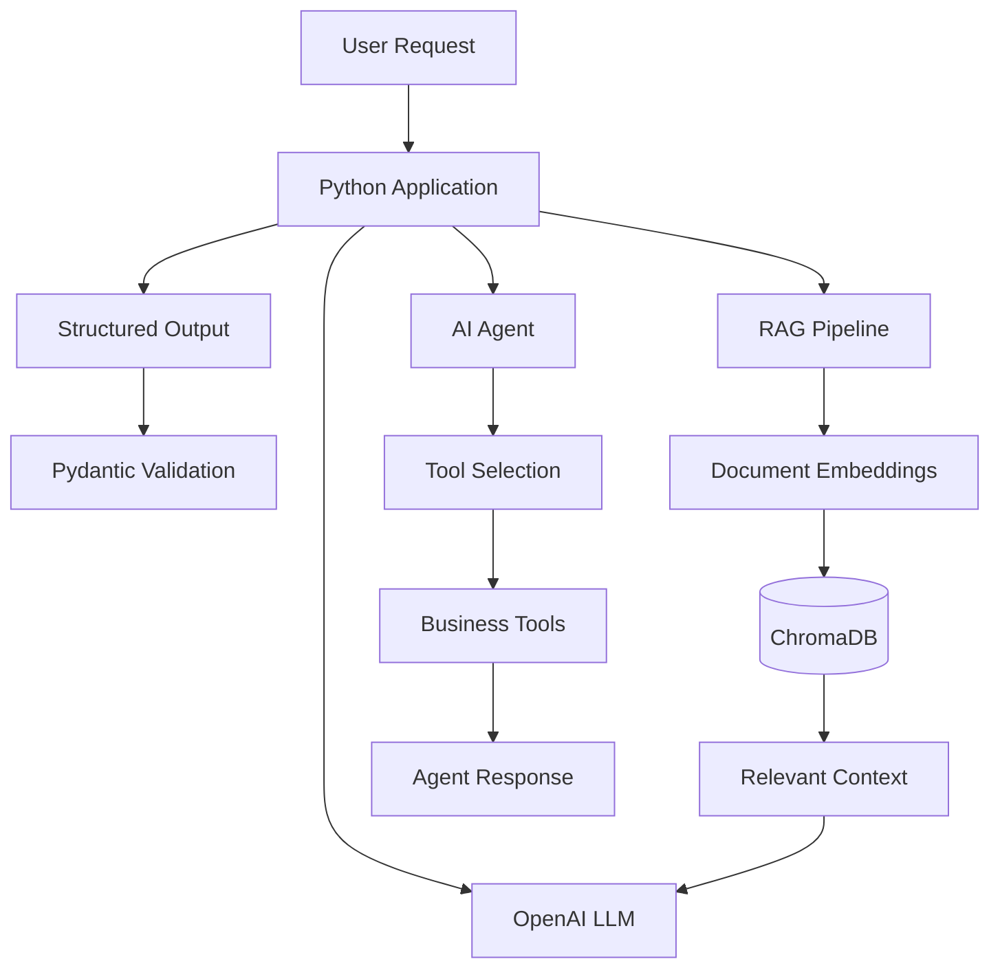

# AI Business Operations Assistant

An AI-powered business operations assistant built using Python, OpenAI, LangChain, and FastAPI. This project explores how Large Language Models (LLMs) can support business workflows through structured SOP generation, document retrieval, semantic search, and AI agents with tool-calling capabilities.

## Features

- **AI-Powered SOP Generation:** Generate structured Standard Operating Procedures from natural-language requests.
- **Structured Outputs:** Use Pydantic models to produce validated, structured LLM responses.
- **Retrieval-Augmented Generation (RAG):** Retrieve relevant information from business documents to provide context-aware answers.
- **Embeddings and Vector Search:** Generate document embeddings and perform semantic retrieval using ChromaDB.
- **LangChain Integration:** Build LLM workflows using prompt templates, model chains, and integrations.
- **AI Agents and Tools:** Implement agents that can use tools to perform business-related tasks.
- **Business Knowledge Base:** Retrieve information from sample shipping and refund policy documents.

## System Architecture

The project explores several LLM application patterns, including structured generation, retrieval-augmented generation, and tool-based AI agents.




## Technology Stack

| Category | Technologies |
|---|---|
| Programming Language | Python |
| LLM | OpenAI API |
| LLM Framework | LangChain |
| API Framework | FastAPI |
| Data Validation | Pydantic |
| Embeddings | OpenAI Embeddings |
| Vector Database | ChromaDB |
| Environment Management | Python Virtual Environment, python-dotenv |

## Project Structure

```text
ai-business-operations-assistant/
│
├── knowledge/
│   ├── refund_policy.txt
│   └── shipping_policy.txt
│
├── app.py
├── main.py
├── embedding_test.py
├── index_documents.py
├── query_rag.py
├── read_document.py
├── structured_test.py
├── langchain_rag.py
├── langchain_tools.py
├── langchain_agent.py
├── requirements.txt
├── .gitignore
└── README.md
```

## Getting Started

### 1. Clone the repository

```bash
git clone https://github.com/AkashGitRep/ai-business-operations-assistant.git
cd ai-business-operations-assistant
```

### 2. Create a virtual environment

```bash
python -m venv .venv
```

Activate the environment.

**macOS / Linux**

```bash
source .venv/bin/activate
```

**Windows**

```bash
.venv\Scripts\activate
```

### 3. Install dependencies

```bash
pip install -r requirements.txt
```

### 4. Configure environment variables

Create a `.env` file in the project root:

```env
OPENAI_API_KEY=your_openai_api_key
```

Never commit your actual API key or `.env` file to GitHub.

## Running the Project

Run the individual modules to explore their respective implementations:

**SOP Generation and Structured Outputs**

```bash
python main.py
```

**LangChain RAG**

```bash
python langchain_rag.py
```

**LangChain Tools**

```bash
python langchain_tools.py
```

**LangChain AI Agent**

```bash
python langchain_agent.py
```

**FastAPI Application**

```bash
uvicorn app:app --reload
```

The FastAPI command assumes the application instance is named `app` inside `app.py`.

## Key Learning Outcomes

This project demonstrates practical implementation of:

- LLM integration using the OpenAI API
- Prompt engineering and prompt templates
- Pydantic-based structured outputs
- Text embeddings and semantic search
- Document indexing and retrieval
- Retrieval-Augmented Generation (RAG)
- LangChain chains and integrations
- Tool calling and AI agent workflows
- Vector database integration using ChromaDB

## Future Enhancements

- Conversation memory and persistent context
- LangGraph-based agent orchestration
- Multi-agent collaboration
- Authentication and role-based access control
- Docker-based deployment
- Monitoring, evaluation, and performance optimization

## Author

**Akash N**

AI Engineer | Generative AI | LLM Applications | RAG | AI Agents | Python

- GitHub: https://github.com/AkashGitRep
- LinkedIn: Add your LinkedIn profile URL here
